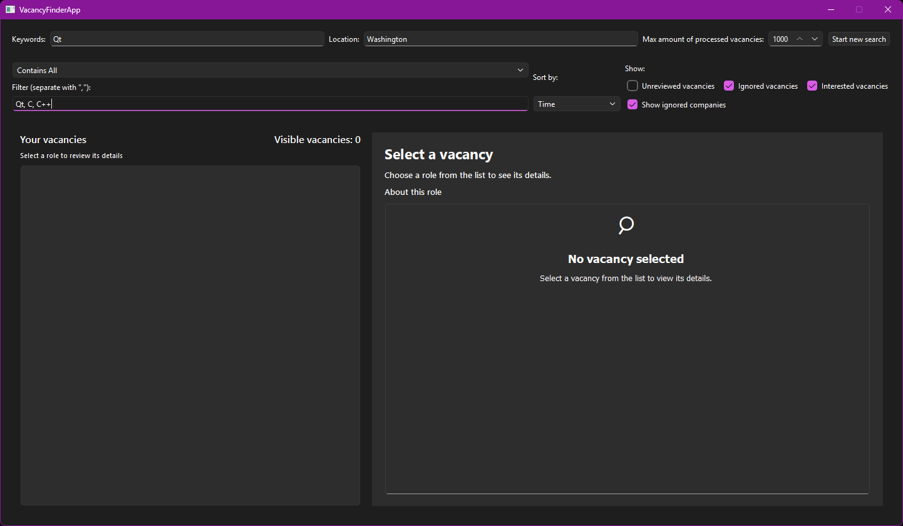
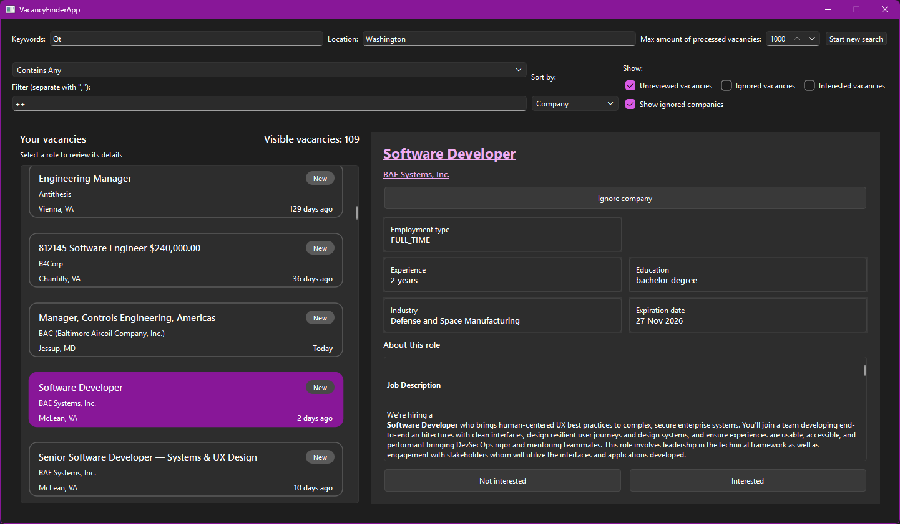
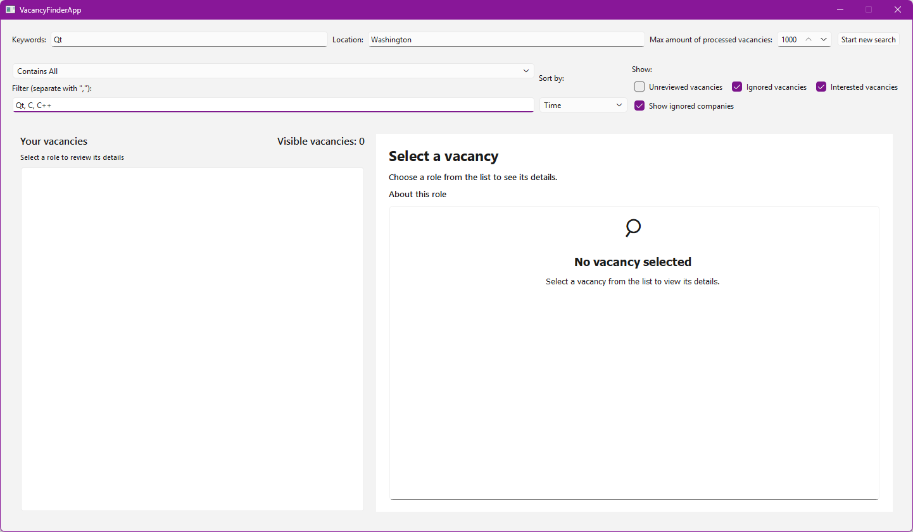
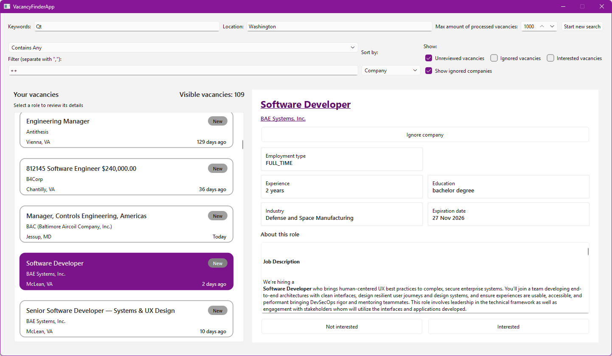

# VacancyFinder

VacancyFinder is a Windows desktop app for finding and organizing job vacancies. Search by keywords and location, then filter, sort, and review the vacancies that match.

LinkedIn is currently the only supported vacancy source. As a rough guide, processing 1,000 vacancies takes about 30 minutes.

## For users

### What it does

- Search vacancies by keywords and location, with a configurable processing limit.
- Filter vacancy text using comma-separated terms. Choose whether results must contain any or all terms, or exclude any or all terms.
- Sort results by relevance, time, title, company, employment type, level, experience, education, skills, industry, or expiration date.
- Review vacancy details and mark vacancies as interested or ignored. Filter the list by review status and choose whether to show ignored companies.

### Screenshots

| Empty search | Search results |
| --- | --- |
|  |  |
|  |  |

## For developers

### Dependencies

- Windows and an x64 MSVC toolchain with C++20 support.
- CMake 4.3 or newer.
- Qt 6 installed and available to CMake.
- GoogleTest for the test suite. CMake fetches it during configuration if it is not already installed.

### Build

Run these commands from an x64 MSVC Developer PowerShell with Qt 6 installed:

```powershell
cmake -S . -B build
cmake --build build --config Release --target VacancyFinderApp
```

If CMake cannot find Qt, pass the Qt installation path with `-DCMAKE_PREFIX_PATH=<Qt-installation-path>` when configuring.

### API documentation

After configuring the project with CMake, generate the API documentation with Doxygen:

```powershell
doxygen build/Doxyfile
```

### Run tests

Build the test executables, then run the registered unit and integration tests with CTest:

```powershell
cmake --build build --config Release
ctest --test-dir build -C Release --output-on-failure
```

To run only tests labeled `unit` or `integration`, add `-L unit` or `-L integration` to the `ctest` command.

### Project layout

- `src/App` coordinates application state and vacancy search workflows.
- `src/Domain` contains vacancy data and filtering/sorting operations.
- `src/Network` and `src/Parsing` implement vacancy requests and vacancy extraction.
- `src/Presentation` and `src/UI` provide the presentation logic and Qt interface.
- `Tests` contains unit and integration tests; `Benchmarks` contains performance benchmarks.
